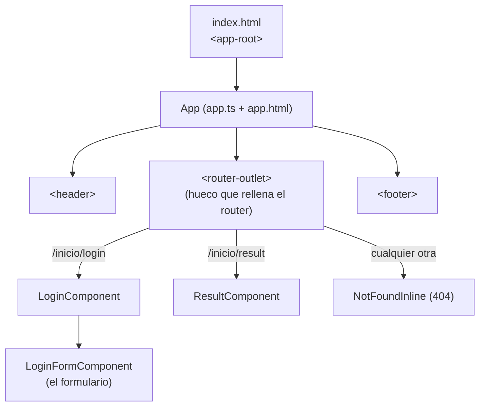
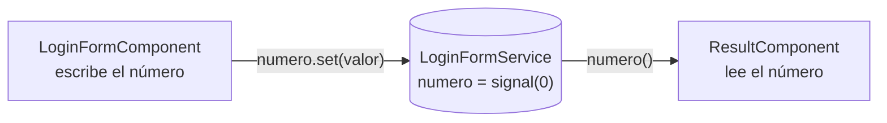
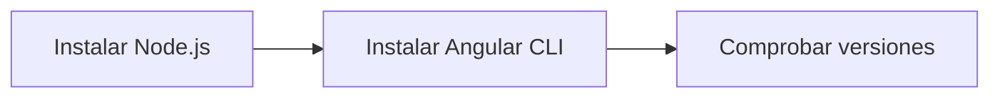
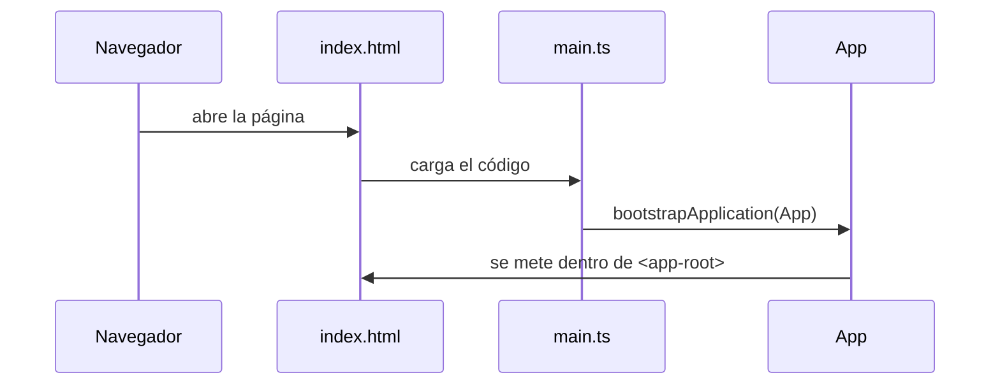
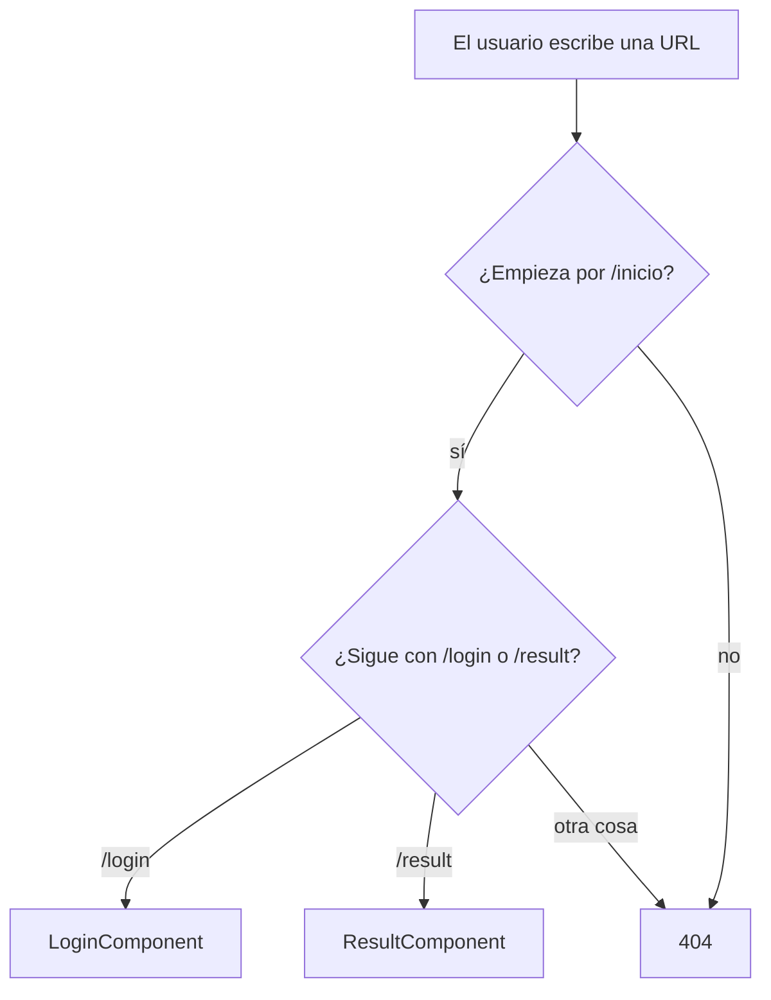
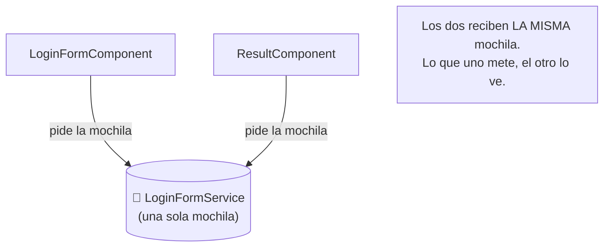
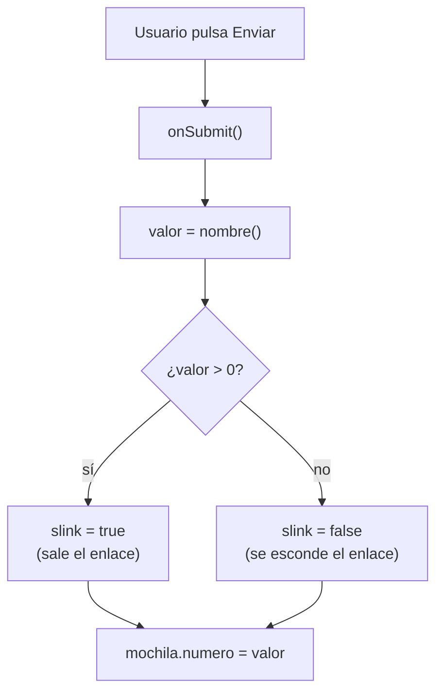
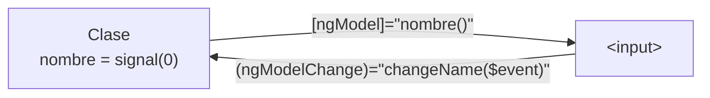
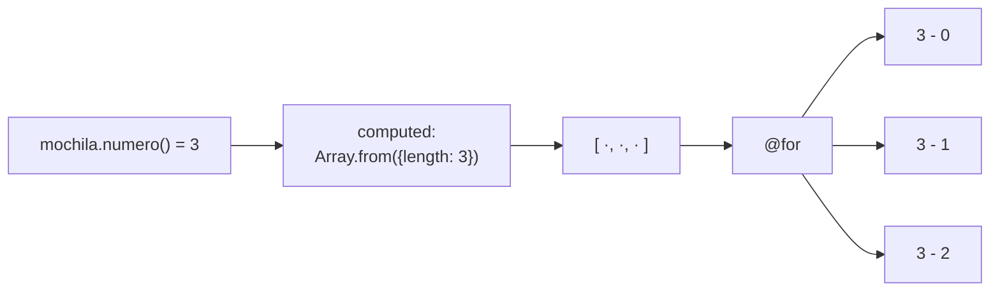

# 🧸 Guía desde CERO: nuestra app de Angular explicada como para un niño

> **¿Qué vamos a construir?**
> Una mini app con dos pantallas:
> 1. **Login** (`/inicio/login`): escribes un número y pulsas **Enviar**.
> 2. **Result** (`/inicio/result`): muestra ese número y lo repite tantas veces como diga el número.
>
> Si escribes `3`, en Result verás:
> ```
> 3
> 3 - 0
> 3 - 1
> 3 - 2
> ```

Cada sección tiene:
- 📄 **El código** completo.
- 🔍 **Línea por línea**: qué hace cada cosa, explicado muy fácil.
- 💥 **Rómpelo**: un cambio a propósito para ver qué pasa cuando algo falla.
- 🔧 **Arréglalo**: cómo volver a dejarlo bien.

---

## 0. Índice

1. [Las palabras mágicas (vocabulario)](#1-las-palabras-mágicas-vocabulario)
2. [El mapa completo de la app](#2-el-mapa-completo-de-la-app)
3. [Preparar el ordenador](#3-preparar-el-ordenador)
4. [Crear el proyecto](#4-crear-el-proyecto)
5. [`index.html` y `main.ts`: donde todo empieza](#5-indexhtml-y-maints-donde-todo-empieza)
6. [`app.config.ts`: la caja de herramientas](#6-appconfigts-la-caja-de-herramientas)
7. [`app.ts` y `app.html`: el componente jefe](#7-appts-y-apphtml-el-componente-jefe)
8. [`app.routes.ts`: el mapa de calles](#8-approutests-el-mapa-de-calles)
9. [El servicio `LoginFormService`: la mochila compartida](#9-el-servicio-loginformservice-la-mochila-compartida)
10. [`LoginComponent`: la habitación](#10-logincomponent-la-habitación)
11. [`LoginFormComponent`: el formulario](#11-loginformcomponent-el-formulario)
12. [`ResultComponent`: la pantalla de resultados](#12-resultcomponent-la-pantalla-de-resultados)
13. [El viaje completo de un número](#13-el-viaje-completo-de-un-número)
14. [Tabla resumen de errores](#14-tabla-resumen-de-errores)
15. [Retos extra](#15-retos-extra)

---

## 1. Las palabras mágicas (vocabulario)

| Palabra | Qué es, en fácil | Ejemplo de la vida real |
|---|---|---|
| **Angular** | Un kit de piezas para construir páginas web. | Un set de LEGO. |
| **Componente** | Una pieza de la página: tiene su dibujo (HTML), su cerebro (TypeScript) y su ropa (CSS). | Una pieza de LEGO. |
| **Template / HTML** | Lo que se **ve** en la pantalla. | La cara de la pieza. |
| **TypeScript (`.ts`)** | Lo que la pieza **piensa y hace**. | El cerebro. |
| **CSS** | Los colores y tamaños. | La ropa. |
| **Signal (`signal`)** | Una cajita que guarda un valor. Cuando cambias lo de dentro, la pantalla se entera sola y se actualiza. | Un marcador de fútbol: cambias el número y todos lo ven. |
| **`computed`** | Una cajita que se calcula a partir de otras. Si las otras cambian, ella se recalcula sola. | Una calculadora que siempre suma lo que hay en otras dos cajas. |
| **Servicio** | Un sitio para guardar datos que **varios componentes comparten**. | Una mochila que se pasan los amigos. |
| **Ruta** | Una dirección dentro de la web (`/inicio/login`). | La dirección de una casa. |
| **Router** | El que mira la dirección y decide qué componente enseñar. | El cartero. |
| **Decorador (`@Component`)** | Una etiqueta que se pone encima de una clase para decirle a Angular qué es. | La etiqueta de “frágil” en una caja. |
| **Clase (`class`)** | El molde con el que se fabrica un componente o servicio. | El molde de galletas. |
| **`import`** | Traer una pieza que está en otro archivo. | Pedirle prestado un juguete a tu hermano. |
| **`export`** | Dejar que otros archivos usen esta pieza. | Prestar tu juguete. |

---

## 2. El mapa completo de la app

### 2.1 Quién está dentro de quién



### 2.2 Quién comparte datos con quién



> 🎒 **Idea clave:** el formulario y la pantalla de resultados **no se conocen**. Se comunican a través de la mochila (el servicio).

### 2.3 Los archivos

```
src/
├── index.html                 ← la página vacía donde se monta todo
├── main.ts                    ← el botón de encendido
├── styles.css                 ← estilos para toda la app
└── app/
    ├── app.config.ts          ← caja de herramientas (router, etc.)
    ├── app.routes.ts          ← mapa de calles (rutas)
    ├── app.ts                 ← cerebro del componente jefe
    ├── app.html               ← dibujo del componente jefe
    ├── app.css
    └── component/
        ├── login/
        │   ├── login.component.ts
        │   ├── login.component.html
        │   └── login.component.css
        ├── login-form/
        │   ├── login-form.component.ts
        │   ├── login-form.component.html
        │   ├── login-form.component.css
        │   └── login-form.service.ts   ← la mochila compartida
        └── result/
            ├── result.component.ts
            ├── result.component.html
            └── result.component.css
```

---

## 3. Preparar el ordenador



1. Descarga e instala **Node.js** (versión LTS) desde la web oficial de Node.
2. Abre una terminal y escribe:

```bash
npm install -g @angular/cli
```

- `npm` = el “supermercado” de piezas de JavaScript.
- `install` = “cómprame esto”.
- `-g` = “para todo el ordenador” (global), no solo para un proyecto.
- `@angular/cli` = la herramienta `ng` que crea y arranca proyectos de Angular.

3. Comprueba que funciona:

```bash
node -v
ng version
```

Si ves números de versión, ✅ todo bien.

> 💥 **Rómpelo:** escribe `ngg version` (con dos g).
> Verás algo como *"ngg no se reconoce como un comando"*.
> 🔧 **Arréglalo:** el ordenador solo entiende las palabras exactas. Escribe `ng`.

---

## 4. Crear el proyecto

```bash
ng new clase_angular
cd clase_angular
ng serve
```

- `ng new clase_angular` → fabrica una carpeta nueva con un proyecto Angular vacío.
- `cd clase_angular` → “entra en esa carpeta”.
- `ng serve` → enciende un servidor en tu ordenador. Abre el navegador en `http://localhost:4200`.

Luego creamos nuestras piezas con el generador:

```bash
ng generate component component/login
ng generate component component/login-form
ng generate component component/result
ng generate service component/login-form/login-form
```

- `ng generate component X` → crea los 4 archivos de un componente (`.ts`, `.html`, `.css`, `.spec.ts`).
- `ng generate service X` → crea un servicio (la mochila).
- Los archivos `.spec.ts` son **pruebas automáticas**. De momento no los tocamos.

> 💥 **Rómpelo:** apaga el servidor (pulsa `Ctrl + C` en la terminal) y recarga el navegador.
> Verás *"No se puede acceder a este sitio"*.
> 🔧 **Arréglalo:** la web solo existe mientras `ng serve` está encendido. Vuelve a escribir `ng serve`.

---

## 5. `index.html` y `main.ts`: donde todo empieza

### 📄 `src/index.html`

```html
<!doctype html>
<html lang="en">
<head>
  <meta charset="utf-8">
  <title>ClaseAngular</title>
  <base href="/">
  <meta name="viewport" content="width=device-width, initial-scale=1">
  <link rel="icon" type="image/x-icon" href="favicon.ico">
</head>
<body>
  <app-root></app-root>
</body>
</html>
```

### 🔍 Línea por línea

| Línea | Qué significa |
|---|---|
| `<!doctype html>` | “Hola navegador, esto es una página web moderna”. |
| `<html lang="en">` | Empieza la página. `lang` dice el idioma. |
| `<head>` | La parte **invisible**: información sobre la página. |
| `<meta charset="utf-8">` | “Entiende tildes, eñes y emojis”. |
| `<title>ClaseAngular</title>` | El texto que sale en la pestaña del navegador. |
| `<base href="/">` | “Todas las direcciones empiezan desde la raíz `/`”. El router lo necesita. |
| `<meta name="viewport" ...>` | “Que se vea bien en el móvil”. |
| `<link rel="icon" ...>` | El dibujito pequeño de la pestaña. |
| `<body>` | La parte **visible**. |
| `<app-root></app-root>` | Un hueco vacío. Angular meterá aquí **toda** la app. |

### 📄 `src/main.ts`

```ts
import { bootstrapApplication } from '@angular/platform-browser';
import { appConfig } from './app/app.config';
import { App } from './app/app';

bootstrapApplication(App, appConfig)
  .catch((err) => console.error(err));
```

### 🔍 Línea por línea

| Línea | Qué significa |
|---|---|
| `import { bootstrapApplication } ...` | Traemos el **botón de encendido** de Angular. |
| `import { appConfig } ...` | Traemos la **caja de herramientas** (ver sección 6). |
| `import { App } ...` | Traemos el **componente jefe**. |
| `bootstrapApplication(App, appConfig)` | “Enciende la app usando `App` como jefe y con estas herramientas”. |
| `.catch((err) => console.error(err));` | “Si algo explota al encender, escribe el error en la consola”. |



> 💥 **Rómpelo:** en `index.html` cambia `<app-root></app-root>` por `<app-raiz></app-raiz>`.
> La página sale **en blanco**. En la consola del navegador (F12) verás un error tipo *"The selector "app-root" did not match any elements"*.
> 🔧 **Arréglalo:** el nombre del hueco tiene que ser igual al `selector` de `App` (`'app-root'`). Vuelve a poner `<app-root></app-root>`.

---

## 6. `app.config.ts`: la caja de herramientas

### 📄 Código

```ts
import { ApplicationConfig, provideBrowserGlobalErrorListeners } from '@angular/core';
import { provideRouter } from '@angular/router';
import { routes } from './app.routes';

export const appConfig: ApplicationConfig = {
  providers: [
    provideBrowserGlobalErrorListeners(),
    provideRouter(routes)
  ]
};
```

### 🔍 Línea por línea

| Línea | Qué significa |
|---|---|
| `import { ApplicationConfig, provideBrowserGlobalErrorListeners } ...` | Traemos el “tipo” de la caja de herramientas y una herramienta que escucha errores. |
| `import { provideRouter } ...` | Traemos la herramienta del **cartero** (router). |
| `import { routes } from './app.routes';` | Traemos nuestro **mapa de calles**. |
| `export const appConfig: ApplicationConfig = {` | Creamos la caja y la prestamos (`export`) para que `main.ts` la use. |
| `providers: [` | La lista de herramientas que metemos en la caja. |
| `provideBrowserGlobalErrorListeners(),` | “Vigila errores en todo el navegador”. |
| `provideRouter(routes)` | “Dale al cartero este mapa de calles”. |

> 💥 **Rómpelo:** borra la línea `provideRouter(routes)`.
> La app no sabe navegar: verás errores como *"No provider for Router"* / *"NG0201"* en la consola.
> 🔧 **Arréglalo:** sin cartero no hay rutas. Vuelve a ponerla.

---

## 7. `app.ts` y `app.html`: el componente jefe

### 📄 `src/app/app.ts`

```ts
import { Component, signal } from '@angular/core';
import { RouterOutlet } from '@angular/router';

@Component({
  imports: [RouterOutlet],
  selector: 'app-root',
  styleUrl: './app.css',
  templateUrl: './app.html',
})
export class App {
  protected readonly title = signal('clase_angular');
  nombre="fernando"
}
```

### 🔍 Línea por línea

| Línea | Qué significa |
|---|---|
| `import { Component, signal } ...` | Traemos la etiqueta `@Component` y las cajitas `signal`. |
| `import { RouterOutlet } ...` | Traemos el **hueco** donde el cartero deja los componentes. |
| `@Component({` | “Ojo Angular, la clase de abajo es un componente”. |
| `imports: [RouterOutlet],` | “En mi HTML voy a usar `<router-outlet>`”. Si no lo pones aquí, el HTML no lo conoce. |
| `selector: 'app-root',` | El **nombre de la etiqueta** con la que se usa este componente: `<app-root>`. |
| `styleUrl: './app.css',` | Dónde está su ropa (CSS). |
| `templateUrl: './app.html',` | Dónde está su dibujo (HTML). |
| `export class App {` | El molde del componente jefe. |
| `protected readonly title = signal('clase_angular');` | Una cajita con el texto `'clase_angular'`. `readonly` = no se puede cambiar la cajita por otra. `protected` = solo la usa este componente y su HTML. |
| `nombre="fernando"` | Una variable normal con un texto. Ahora mismo no se usa en el HTML. |
| `}` | Fin del molde. |

### 📄 `src/app/app.html`

```html
<header></header>

<router-outlet/>
<footer></footer>
```

| Línea | Qué significa |
|---|---|
| `<header></header>` | La cabecera (de momento vacía). Siempre se ve. |
| `<router-outlet/>` | El **hueco mágico**. El cartero mete aquí Login, Result o el 404 según la dirección. |
| `<footer></footer>` | El pie de página (vacío). Siempre se ve. |

```
┌──────────────── App ────────────────┐
│ <header>                            │  ← siempre igual
├─────────────────────────────────────┤
│ <router-outlet>                     │  ← cambia según la URL
│    Login  /  Result  /  404         │
├─────────────────────────────────────┤
│ <footer>                            │  ← siempre igual
└─────────────────────────────────────┘
```

> 💥 **Rómpelo:** en `app.ts` borra `RouterOutlet` de `imports: [...]` (deja `imports: []`).
> Error en la terminal: *"'router-outlet' is not a known element"*.
> 🔧 **Arréglalo:** cada etiqueta especial que uses en el HTML debe estar en `imports`. Vuelve a poner `RouterOutlet`.

> 💥 **Rómpelo 2:** en `app.html` añade `<h1>Hola {{ nombre }}</h1>` arriba del todo.
> ¡No se rompe! Verás *"Hola fernando"*. Las `{{ }}` sirven para **pintar una variable** en el HTML.
> Ahora escribe `{{ nombr }}` (sin la e) → error: *"Property 'nombr' does not exist on type 'App'"*.
> 🔧 **Arréglalo:** el nombre dentro de `{{ }}` tiene que ser exactamente igual al de la clase.

---

## 8. `app.routes.ts`: el mapa de calles

### 📄 Código

```ts
import { Routes } from '@angular/router';
import { App } from './app';
import { Component } from '@angular/core';
import { LoginComponent } from './component/login/login.component';
import { ResultComponent } from './component/result/result.component';

@Component({
  template: `<h1>404 - Página no encontrada</h1>`,
})
class NotFoundInline {}
export const routes: Routes = [
  { path: 'inicio',
    children: [
        { path: 'login', component: LoginComponent },
        { path: 'result', component: ResultComponent }

    ]
 },
  { path: '**', component: NotFoundInline },
];
```

### 🔍 Línea por línea

| Línea | Qué significa |
|---|---|
| `import { Routes } ...` | El “tipo” de un mapa de calles. |
| `import { App } from './app';` | Traemos `App`… pero **no se usa** aquí. Se podría borrar. |
| `import { Component } ...` | Traemos `@Component` porque abajo creamos un componente pequeñito. |
| `import { LoginComponent } ...` | Traemos la pantalla de Login. |
| `import { ResultComponent } ...` | Traemos la pantalla de Result. |
| `@Component({ template: \`...\` })` | Creamos un componente **dentro de este archivo**, sin archivos `.html` aparte. `template` es el HTML escrito directamente entre comillas invertidas. |
| `class NotFoundInline {}` | El molde de ese componente. Está vacío porque no piensa nada, solo enseña el 404. |
| `export const routes: Routes = [` | Empieza la lista de calles. |
| `{ path: 'inicio',` | Una calle llamada `inicio`… |
| `children: [` | …que tiene **calles hijas** dentro. |
| `{ path: 'login', component: LoginComponent },` | `/inicio/login` → enseña `LoginComponent`. |
| `{ path: 'result', component: ResultComponent }` | `/inicio/result` → enseña `ResultComponent`. |
| `{ path: '**', component: NotFoundInline },` | `**` = **“cualquier otra cosa”**. Si nadie coincide, enseña el 404. |



> ⚠️ **El orden importa.** El cartero lee la lista **de arriba a abajo** y se queda con la primera que coincide.

> 💥 **Rómpelo:** mueve `{ path: '**', component: NotFoundInline }` al **principio** de la lista.
> Ahora `/inicio/login` también enseña el 404, porque `**` coincide con todo y está primero.
> 🔧 **Arréglalo:** el comodín `**` siempre va **el último**.

> 💥 **Rómpelo 2:** visita `http://localhost:4200/` (sin nada).
> Sale el 404, porque no hay ninguna ruta con `path: ''`.
> 🔧 **Arréglalo (mejora):** añade al principio de la lista una redirección:
> ```ts
> { path: '', redirectTo: 'inicio/login', pathMatch: 'full' },
> ```
> - `path: ''` = la dirección vacía.
> - `redirectTo` = “mándalo a esta otra calle”.
> - `pathMatch: 'full'` = “solo si la dirección está **totalmente** vacía”.

---

## 9. El servicio `LoginFormService`: la mochila compartida

### 📄 `login-form.service.ts`

```ts
import { Service, signal } from '@angular/core';

@Service()
export class LoginFormService {

    numero=signal(0)
}
```

### 🔍 Línea por línea

| Línea | Qué significa |
|---|---|
| `import { Service, signal } ...` | Traemos la etiqueta `@Service` y las cajitas `signal`. |
| `@Service()` | “Esta clase es un servicio”. Angular crea **una sola** mochila para toda la app y se la da a quien la pida. |
| `export class LoginFormService {` | El molde de la mochila. |
| `numero=signal(0)` | Dentro de la mochila hay una cajita llamada `numero` que empieza valiendo `0`. |

### Cómo se usa una signal

```ts
numero()        // 👀 MIRAR lo que hay dentro  → 0
numero.set(5)   // ✋ CAMBIAR lo que hay dentro → ahora vale 5
```

> 🧠 **Muy importante:** para **leer** una signal hay que ponerle paréntesis `()`. Sin paréntesis tienes la cajita, no lo que hay dentro.



> 💥 **Rómpelo:** cambia `signal(0)` por `signal(4)`.
> No se rompe, pero ahora si vas directamente a `/inicio/result` verás el número 4 repetido 4 veces. Es el **valor inicial**.
> 🔧 **Arréglalo:** vuelve a `signal(0)`.

---

## 10. `LoginComponent`: la habitación

### 📄 `login.component.ts`

```ts
import { Component } from '@angular/core';
import { LoginFormComponent } from '../login-form/login-form.component';

@Component({
  imports: [LoginFormComponent],
  selector: 'app-login',
  styleUrl: './login.component.css',
  templateUrl: './login.component.html',
})
export class LoginComponent {}
```

| Línea | Qué significa |
|---|---|
| `import { Component } ...` | La etiqueta de componente. |
| `import { LoginFormComponent } from '../login-form/...'` | Traemos el formulario. `../` = “sube una carpeta”. |
| `imports: [LoginFormComponent],` | “En mi HTML voy a usar `<app-login-form>`”. |
| `selector: 'app-login',` | Mi etiqueta es `<app-login>`. |
| `styleUrl / templateUrl` | Mi ropa y mi dibujo. |
| `export class LoginComponent {}` | No piensa nada: solo es una **habitación** que contiene el formulario. |

### 📄 `login.component.html`

```html
<p>login works!</p>
<app-login-form></app-login-form>
```

| Línea | Qué significa |
|---|---|
| `<p>login works!</p>` | Un texto para comprobar que la pantalla carga. |
| `<app-login-form></app-login-form>` | “Pon aquí el formulario”. |

> 💥 **Rómpelo:** quita `LoginFormComponent` de `imports`.
> Error: *"'app-login-form' is not a known element"*.
> 🔧 **Arréglalo:** vuelve a importarlo. **Regla de oro:** etiqueta que usas en el HTML = pieza que tienes que poner en `imports`.

---

## 11. `LoginFormComponent`: el formulario

Esta es la pieza más importante. Vamos despacio.

### 📄 `login-form.component.ts`

```ts
import { Component, signal } from '@angular/core';
import { FormsModule } from '@angular/forms';
import { RouterLink } from '@angular/router';
import { LoginFormService } from './login-form.service';
@Component({
  imports: [FormsModule, RouterLink],
  selector: 'app-login-form',
  styleUrl: './login-form.component.css',
  templateUrl: './login-form.component.html',
})
export class LoginFormComponent {

  numeroservice: any = '';
  constructor(numeroService: LoginFormService) {
    this.numeroservice = numeroService;
  }

  slink = signal(false);
  nombre = signal(0);


  onSubmit() {
    let numero = this.numeroservice.numero;
    console.log(this.numeroservice.numero());
    const valor = this.nombre();
    if (valor > 0) {
      this.slink.set(true);
      numero.set(valor);
    } else {
      this.slink.set(false);
      numero.set(valor);
    }
    console.log(this.numeroservice.numero())
  }

  changeName(value: any) {
    this.nombre.set(value);
  }
}
```

### 🔍 Línea por línea

**Los imports**

| Línea | Qué significa |
|---|---|
| `import { Component, signal } ...` | Etiqueta de componente y cajitas. |
| `import { FormsModule } ...` | Herramientas para formularios: `ngModel` y `ngSubmit`. |
| `import { RouterLink } ...` | Para hacer enlaces que usan el cartero (`routerLink`). |
| `import { LoginFormService } ...` | La mochila. `./` = “en esta misma carpeta”. |

**El decorador**

| Línea | Qué significa |
|---|---|
| `imports: [FormsModule, RouterLink],` | “En mi HTML uso cosas de formularios y enlaces del router”. |
| `selector: 'app-login-form',` | Mi etiqueta es `<app-login-form>`. |

**Pedir la mochila**

| Línea | Qué significa |
|---|---|
| `numeroservice: any = '';` | Una variable donde guardaremos la mochila. `any` = “puede ser cualquier cosa” (es cómodo pero no nos avisa de errores). Empieza con `''` (texto vacío) solo para no estar vacía. |
| `constructor(numeroService: LoginFormService) {` | El **constructor** se ejecuta una vez, cuando nace el componente. Al poner `LoginFormService` aquí, Angular nos **da la mochila** automáticamente. Esto se llama **inyección de dependencias**. |
| `this.numeroservice = numeroService;` | Guardamos la mochila en nuestra variable para usarla después. `this` = “yo mismo, este componente”. |

**Las cajitas propias**

| Línea | Qué significa |
|---|---|
| `slink = signal(false);` | Cajita que dice si se **enseña el enlace** a Result. Empieza en `false` (no). |
| `nombre = signal(0);` | Cajita con el número que escribe el usuario. Se llama `nombre` pero guarda un **número** (nombre heredado de una versión anterior). |

**`onSubmit()`: lo que pasa al pulsar Enviar**

| Línea | Qué significa |
|---|---|
| `onSubmit() {` | Una acción. Se ejecuta cuando se envía el formulario. |
| `let numero = this.numeroservice.numero;` | Cogemos **la cajita** `numero` de la mochila (sin paréntesis = la cajita entera). |
| `console.log(this.numeroservice.numero());` | Escribimos en la consola lo que había **antes**. |
| `const valor = this.nombre();` | Miramos qué número escribió el usuario. |
| `if (valor > 0) {` | “Si el número es mayor que 0…” |
| `this.slink.set(true);` | …enseña el enlace… |
| `numero.set(valor);` | …y mete el número en la mochila. |
| `} else {` | “Si no (0 o negativo)…” |
| `this.slink.set(false);` | …esconde el enlace… |
| `numero.set(valor);` | …y también guarda el número en la mochila. |
| `console.log(this.numeroservice.numero())` | Escribimos en la consola lo que hay **ahora**. |

**`changeName()`: cada vez que tecleas**

| Línea | Qué significa |
|---|---|
| `changeName(value: any) {` | Acción que recibe el valor nuevo del recuadro. |
| `this.nombre.set(value);` | Lo guardamos en nuestra cajita `nombre`. |



### 📄 `login-form.component.html`

```html
<p>login-form works!</p>
<h1>{{nombre()}}</h1>
<form (ngSubmit)="onSubmit()">
    @if(slink()===true){

        <a routerLink="/inicio/result">Result</a>
    }
    <p>
    <label for="nombre">Nombre</label>

    <input  [ngModel]="nombre()" (ngModelChange)="changeName($event)" type="number" name="nombre"
        placeholder="Ingrese su nombre">

    <button type="submit">Enviar</button>
</form>
```

### 🔍 Línea por línea

| Línea | Qué significa |
|---|---|
| `<p>login-form works!</p>` | Texto de prueba. |
| `<h1>{{nombre()}}</h1>` | Un título grande que enseña lo que hay en la cajita `nombre`. Como es una signal, se actualiza **solo** mientras escribes. |
| `<form (ngSubmit)="onSubmit()">` | Un formulario. Los **paréntesis `( )`** significan **“cuando pase esto, haz aquello”**: cuando se envíe, llama a `onSubmit()`. |
| `@if(slink()===true){` | “**Solo si** `slink` vale `true`, dibuja lo de dentro”. `===` = “es exactamente igual a”. |
| `<a routerLink="/inicio/result">Result</a>` | Un enlace que le dice al cartero “llévame a `/inicio/result`” **sin recargar** la página. |
| `}` | Fin del `@if`. |
| `<label for="nombre">Nombre</label>` | Texto que explica qué escribir. `for` lo une con el input que tiene `name/id` `nombre`. |
| `<input` | El recuadro donde escribes. |
| `[ngModel]="nombre()"` | Los **corchetes `[ ]`** significan **“de la clase al HTML”**: el recuadro enseña lo que hay en `nombre`. |
| `(ngModelChange)="changeName($event)"` | **“Del HTML a la clase”**: cada vez que tecleas, llama a `changeName` con el valor nuevo. `$event` = “lo que acaba de pasar” (el valor nuevo). |
| `type="number"` | El recuadro solo deja escribir números (y tiene flechitas). |
| `name="nombre"` | Nombre del campo. **`ngModel` dentro de un `<form>` lo necesita sí o sí.** |
| `placeholder="Ingrese su nombre"` | Texto gris de ayuda cuando está vacío. (Dice “nombre” pero pide un número 😉). |
| `<button type="submit">Enviar</button>` | Botón que **envía** el formulario → dispara `(ngSubmit)`. |
| `</form>` | Fin del formulario. |

### 🧠 Chuleta de símbolos

```
 {{ algo }}     →  PINTAR un valor en el HTML           (clase ➜ pantalla)
 [prop]="x"     →  DAR un valor a una propiedad          (clase ➜ pantalla)
 (evento)="f()" →  ESCUCHAR algo que hace el usuario     (pantalla ➜ clase)
 [(ngModel)]    →  las dos cosas a la vez ("banana en caja")
```



### 💥 Rompe el formulario (5 experimentos)

> 💥 **1. Quita `FormsModule` de `imports`.**
> Error: *"Can't bind to 'ngModel' since it isn't a known property of 'input'"*.
> 🔧 `ngModel` vive en `FormsModule`. Vuelve a importarlo.

> 💥 **2. Borra `name="nombre"` del `<input>`.**
> Error en la consola del navegador: *"If ngModel is used within a form tag, either the name attribute must be set..."*.
> 🔧 Dentro de un `<form>`, cada `ngModel` necesita su `name`. Vuelve a ponerlo.

> 💥 **3. Quita los paréntesis: `@if(slink===true)`.**
> El enlace **nunca** aparece (y Angular puede avisarte de que comparas una función con `true`).
> 🔧 `slink` es la **cajita**; `slink()` es **lo que hay dentro**. Para leer una signal: paréntesis.

> 💥 **4. Quita `RouterLink` de `imports`.**
> El enlace aparece pero **no hace nada** al pulsarlo (o recarga la página entera), porque `routerLink` ya no es especial, es solo texto.
> 🔧 Vuelve a importarlo.

> 💥 **5. Cambia `type="number"` por `type="text"` y escribe `3`.**
> Truco: ahora `$event` es el **texto** `"3"`, no el número `3`. JavaScript compara `"3" > 0` y da `true` (lo convierte), pero en Result `Array.from({ length: "3" })` también funciona por suerte… y si escribes `hola`, `"hola" > 0` es `false` y la mochila guarda `"hola"` → Result enseña `hola` y 0 repeticiones.
> 🔧 Vuelve a `type="number"`. Y mejor aún, escribe `changeName(value: number)` en vez de `any`, para que TypeScript te avise.

---

## 12. `ResultComponent`: la pantalla de resultados

### 📄 `result.component.ts`

```ts
import { Component, computed } from '@angular/core';
import { LoginFormService } from '../login-form/login-form.service';

@Component({
  imports: [],
  selector: 'app-result',
  styleUrl: './result.component.css',
  templateUrl: './result.component.html',
})
export class ResultComponent {
  numerosignal: any = 0;
  constructor(private numeroService: LoginFormService) {
    this.numerosignal = numeroService;
  }
  repeticiones = computed(() => Array.from({ length: this.numerosignal.numero() }));
}
```

### 🔍 Línea por línea

| Línea | Qué significa |
|---|---|
| `import { Component, computed } ...` | Etiqueta de componente y las cajitas **calculadas**. |
| `import { LoginFormService } from '../login-form/...'` | La **misma** mochila que usa el formulario. |
| `imports: [],` | No usa etiquetas especiales en su HTML. (`@for` y `@if` no hace falta importarlos.) |
| `selector: 'app-result',` | Mi etiqueta es `<app-result>`. |
| `numerosignal: any = 0;` | Variable para guardar la mochila. (Se llama “signal” pero guarda el **servicio** entero.) |
| `constructor(private numeroService: LoginFormService) {` | Angular nos da la mochila. `private` además la guarda como `this.numeroService` automáticamente. |
| `this.numerosignal = numeroService;` | La guardamos también en `numerosignal` (para usarla en el HTML). |
| `repeticiones = computed(() => ...)` | Una cajita **calculada**: se recalcula sola cada vez que cambie `numero` en la mochila. |
| `Array.from({ length: this.numerosignal.numero() })` | Fabrica una lista **vacía** con tantos huecos como diga el número. Si `numero` es 3 → `[undefined, undefined, undefined]`. No nos importa qué hay dentro, solo **cuántos** hay. |

### 📄 `result.component.html`

```html
<p>{{numerosignal.numero()}}</p>

@for(item of repeticiones();track $index){
<p>{{numerosignal.numero()}} - {{$index}}</p>

}
```

| Línea | Qué significa |
|---|---|
| `<p>{{numerosignal.numero()}}</p>` | Pinta el número que hay en la mochila. |
| `@for(item of repeticiones(); track $index){` | “**Repite** lo de dentro una vez por cada elemento de la lista `repeticiones`”. `item` = el elemento de cada vuelta. `track $index` = Angular reconoce cada vuelta por su posición (0, 1, 2…). |
| `<p>{{numerosignal.numero()}} - {{$index}}</p>` | En cada vuelta pinta el número y la **posición** de la vuelta. `$index` empieza en **0**. |
| `}` | Fin del bucle. |



### 💥 Rompe la pantalla de resultados

> 💥 **1. Quita `track $index`: `@for(item of repeticiones()){`.**
> Error de compilación: *"@for loop must have a 'track' expression"*.
> 🔧 En Angular moderno `track` es **obligatorio**. Vuelve a ponerlo.

> 💥 **2. Quita los paréntesis: `@for(item of repeticiones; track $index)`.**
> Error: algo como *"repeticiones is not iterable"* / no se puede recorrer.
> 🔧 `repeticiones` es una cajita calculada; hay que abrirla con `()`.

> 💥 **3. Recarga la página estando en `/inicio/result` (F5).**
> ¡El número vuelve a `0`! 😱
> 🔧 No es un error de código: la mochila vive **en la memoria** del navegador. Al recargar, la app nace de nuevo y `numero` vuelve a `signal(0)`. Para que sobreviva habría que guardarlo en `localStorage` (ver Retos).

> 💥 **4. En el formulario escribe `-2` y envía. Luego ve a `/inicio/result` a mano.**
> Error en consola: *"Invalid array length"*. Una lista no puede tener longitud negativa.
> 🔧 Protégelo en el `computed`:
> ```ts
> repeticiones = computed(() =>
>   Array.from({ length: Math.max(0, this.numerosignal.numero()) })
> );
> ```
> `Math.max(0, x)` = “dame el mayor entre 0 y x” → nunca es negativo.

> 💥 **5. Cambia `computed(...)` por un array normal:**
> ```ts
> repeticiones = Array.from({ length: this.numerosignal.numero() });
> ```
> (y en el HTML `repeticiones` sin paréntesis).
> Funciona… pero se calcula **una sola vez** al nacer el componente y **nunca más** se actualiza.
> 🔧 `computed` es lo que hace que se recalcule solo. Vuelve a ponerlo.

---

## 13. El viaje completo de un número

```mermaid
sequenceDiagram
    actor U as Usuario
    participant I as <input>
    participant LF as LoginFormComponent
    participant S as LoginFormService (mochila)
    participant RT as Router (cartero)
    participant R as ResultComponent

    U->>I: escribe "3"
    I->>LF: (ngModelChange) → changeName(3)
    LF->>LF: nombre.set(3)  →  <h1> muestra 3
    U->>LF: pulsa "Enviar"
    LF->>LF: onSubmit(): 3 > 0 → slink.set(true)
    LF->>S: numero.set(3)
    LF-->>U: aparece el enlace "Result"
    U->>RT: clic en routerLink="/inicio/result"
    RT->>R: crea ResultComponent en <router-outlet>
    R->>S: numero()  →  3
    R->>R: repeticiones = [·,·,·]
    R-->>U: muestra "3", "3 - 0", "3 - 1", "3 - 2"
```



**Resumen en 6 pasos:**
1. Escribes → `changeName` guarda en `nombre`.
2. Pulsas Enviar → `onSubmit` mira si es mayor que 0.
3. Si lo es → aparece el enlace y el número va a la mochila.
4. Pulsas el enlace → el cartero cambia de pantalla sin recargar.
5. Result abre la mochila y lee el número.
6. `computed` + `@for` lo repiten tantas veces como diga el número.

---

## 14. Tabla resumen de errores

| Lo que ves | Por qué pasa | Cómo se arregla |
|---|---|---|
| Página en blanco | El `selector` no coincide con la etiqueta de `index.html`. | Que sean iguales: `app-root`. |
| `'xxx' is not a known element` | Usas una etiqueta en el HTML que no está en `imports`. | Añade el componente/directiva a `imports`. |
| `Can't bind to 'ngModel'` | Falta `FormsModule`. | Añade `FormsModule` a `imports`. |
| `ngModel ... name attribute must be set` | Input con `ngModel` dentro de `<form>` sin `name`. | Pon `name="algo"`. |
| El `@if` nunca se cumple | Lees la signal sin `()`. | `slink()` en vez de `slink`. |
| `@for loop must have a 'track'` | Falta `track`. | `track $index` (o un id). |
| Siempre sale el 404 | `**` está antes que las otras rutas. | Pon `**` al final. |
| El número vuelve a 0 al recargar | Las signals viven en memoria. | Guardar en `localStorage`. |
| `Invalid array length` | Número negativo en `Array.from`. | `Math.max(0, n)`. |
| `No provider for Router` | Falta `provideRouter` en `app.config.ts`. | Vuelve a añadirlo. |
| Falla `ng test` en `app.spec.ts` | La prueba busca un `<h1>` con *"Hello, clase_angular"* que ya borramos de `app.html`. | Actualiza o borra esa prueba. |

---

## 15. Retos extra

1. **Ruta por defecto:** que `http://localhost:4200/` lleve a `/inicio/login` (pista en la sección 8).
2. **Botón de volver:** en `result.component.html` añade `<a routerLink="/inicio/login">Volver</a>` (¡recuerda importar `RouterLink`!).
3. **Renombrar bien:** cambia la signal `nombre` por `cantidad` en la clase **y** en el HTML. ¿Cuántos sitios tuviste que tocar?
4. **Quitar los `any`:** cambia `numeroservice: any` por `numeroservice: LoginFormService` y mira qué errores te enseña TypeScript.
5. **Usar `inject()`** en vez del constructor:
   ```ts
   import { inject } from '@angular/core';
   numeroService = inject(LoginFormService);
   ```
6. **Que no se olvide:** al hacer `numero.set(valor)` guarda también `localStorage.setItem('numero', String(valor))`, y en el servicio empieza con `signal(Number(localStorage.getItem('numero') ?? 0))`.
7. **Arreglar la prueba rota** de `app.spec.ts` para que `ng test` pase en verde.

---

🎉 **¡Enhorabuena!** Si has roto y arreglado cada cosa, ya entiendes: componentes, rutas, signals, `computed`, servicios, formularios con `ngModel`, `@if` y `@for`.
